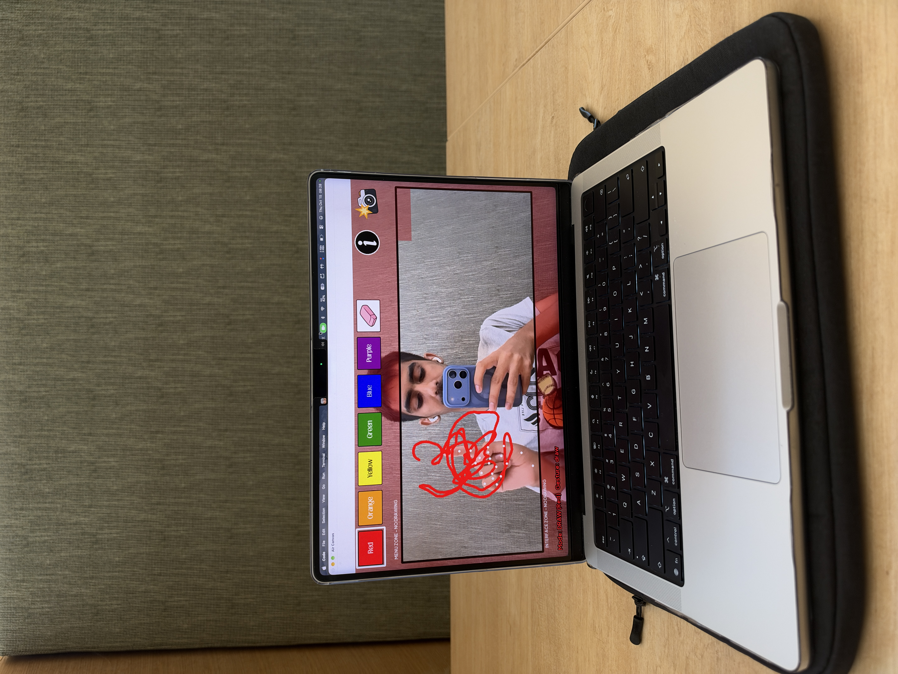

# Air Canvas 🎨

> A touchless drawing tool that lets you paint in the air using just your webcam and hand movements.

<p align= "left">
  
</p>

## About
Air Canvas turns your hand into a stylus. A webcam tracks your fingers in real time, and different hand gestures switch between drawing, selecting colors, and clearing the canvas, with no mouse or touchscreen needed. I built it as my first prompt engineering project, to learn how to turn an idea into a working app by writing clear, iterative prompts.

**Current version: v2.** See [What's new in v2](#whats-new-in-v2) below.

## What's new in v2
v1 covered the basics: draw, select colors, and clear. v2 makes it a more complete drawing tool:

- **More colors:** the palette grew from 6 to **[NUMBER] colors**
- **Stylus Mode:** a stylus menu with different stylus types: (pen, pencil, crayon, highlighter, paint brush)
- **Trace & Play mode:** type a name or hover an emoji to get a gray outline to trace over (see [Features](#features))


### Version history
| Version | Highlights |
| --- | --- |
| v1 | Draw / Cursor / Clear modes, 6 colors and eraser, screenshot, welcome screen with hand calibration |
| v2 | More colors, Stylus Mode, Trace & Play |

## How I built it
I built v1 with Claude Code in **13** prompts, then v2 in **7** more prompts:
- **Structured prompts:** each prompt followed a Role → Task → Context → Constraints format.
- **Iterative prompting:** I tested every version, noted what worked and what didn't, and used that to write the next prompt.
- **Commit per prompt:** in v2, I committed to GitHub after every prompt so the history shows how the app grew step by step.
- **Code review:** after each version, I went through the code line by line and wrote the comments to understand the code.

See every prompt, along with my reflection on each one, in [prompts/PROMPTS.md](prompts/PROMPTS.md).

## Features
| Mode | Gesture | What it does |
| --- | --- | --- |
| Draw Mode | ☝️ Index finger up | Draw on the canvas (or erase, when the eraser is selected) |
| Cursor Mode | ✌️ Index + middle fingers up | Move around without drawing; hover over a color, stylus, or the eraser to select it |
| Clear Mode | ✊ Closed fist | Clear the whole canvas after a 3-2-1 countdown (open your hand to cancel) |

Also includes:
- **24 colors** and an eraser in the top toolbar
- **Stylus Mode:** hover the stylus button to open the brush menu and pick a different stylus 
- **Trace & Play:** hover the button under the camera, then type a name (Enter) or hover an emoji to get a gray outline to trace over. The eraser and fist-clear leave the outline alone; use "Clear outline" to remove it
- Screenshot button: point at the camera icon to save your drawing to Downloads
- Info button: reopens the instructions screen
- Shaded no-draw zones and a flashing warning near the edges
- Welcome screen with hand calibration

## Getting started

Requires a webcam and **Python 3.12** (newer versions may not support MediaPipe yet).

### 👩‍💻 For developers

```bash
git clone https://github.com/aineshkumar7official/air-canvas.git
cd air-canvas
pip install -r requirements.txt
python3 airCanvasv2.py
```

The hand-tracking model (`hand_landmarker.task`) downloads automatically on first run. Press **q** or **Esc** to quit.

Want the original? `airCanvasv1.py` is still in the repo (or check out the `v1` tag).

### 🙋 Not technical? Follow these steps

<details>
<summary><b>Click to expand the step-by-step guide</b></summary>

#### 1. Install Python
Download [Python 3.12](https://www.python.org/downloads/) and install it.
**Windows:** tick **"Add Python to PATH"** on the first install screen.

#### 2. Download Air Canvas
**[⬇️ Click here to download Air Canvas (ZIP)](https://github.com/aineshkumar7official/air-canvas/archive/refs/heads/main.zip)**

Then find the downloaded file (usually in your **Downloads** folder) and double-click it to unzip. You'll get a folder called `air-canvas-main`.

<sub>Or download it from GitHub yourself: scroll to the top of this page → click the green <kbd>&lt;&gt; Code</kbd> button (above the file list, on the right) → click <kbd>Download ZIP</kbd>.</sub>

#### 3. Open a terminal in the folder
- **Mac:** open the **Terminal** app, type `cd ` (with a space), drag the `air-canvas-main` folder into the window, and press Enter.
- **Windows:** open the `air-canvas-main` folder, click the address bar at the top, type `cmd`, and press Enter.

#### 4. Install and run
| | Mac | Windows |
| --- | --- | --- |
| Install (one time only) | `pip3 install -r requirements.txt` | `pip install -r requirements.txt` |
| Start Air Canvas | `python3 airCanvasv2.py` | `python airCanvasv2.py` |

The first launch needs internet. After that, hold up your index finger for 2 seconds to start drawing. Press **q** to quit.

#### Troubleshooting
| Problem | Fix |
| --- | --- |
| Mac: black screen or no camera | System Settings → Privacy & Security → Camera → turn on **Terminal**, then reopen Terminal |
| `pip` or `python` not found | On Mac use `pip3` / `python3`. On Windows, reinstall Python with "Add to PATH" ticked |
| MediaPipe won't install | Make sure you installed Python 3.12 |
| Icons look like plain boxes | That's expected. Custom design assets aren't included, so built-in shapes are used |

</details>

## Tech stack
- **Python**
- **OpenCV:** webcam input, drawing, and the app window
- **MediaPipe:** tracks 21 points on your hand
- **NumPy:** stores images as arrays
- **Pillow:** renders the custom fonts

## Roadmap
See [ROADMAP.md](ROADMAP.md)

## Author
**Ainesh Kumar**<br>
USF | B.S. Computer Science & Business, FinTech | Class of 2030<br>
[LinkedIn](https://www.linkedin.com/in/aineshkumarofficial/) · [GitHub](https://github.com/aineshkumar7official)

## License
MIT. See [LICENSE](LICENSE).
